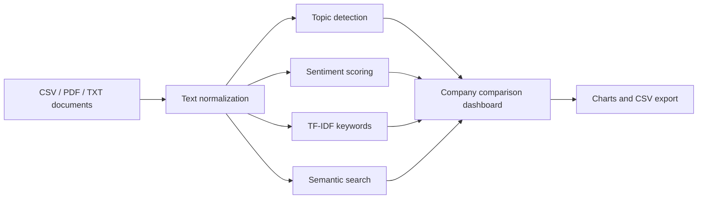

# ChipIntel NLP

### Turn semiconductor reports into explainable market signals

[](https://www.python.org/)
[](https://streamlit.io/)
[](https://github.com/rlaaudwp96/chipintel-nlp)

ChipIntel is an interactive NLP dashboard for comparing how semiconductor companies talk about AI, supply chains, competition, manufacturing, and risk. It is designed for analysts who need to move from a large collection of reports to a clear, defensible comparison quickly.

The demo corpus covers NVIDIA, AMD, Broadcom, TSMC, Micron, and ASML. Instead of returning a black-box label, the dashboard shows the topics, keywords, sentiment signals, and source documents behind each comparison.

## Contents

- [Why this project is useful](#why-this-project-is-useful)
- [Explore the dashboard](#explore-the-dashboard)
- [Quick start](#quick-start)
- [Use your own data](#use-your-own-data)
- [Technical workflow](#technical-workflow)
- [Project structure](#project-structure)
- [Reproducibility and limitations](#reproducibility-and-limitations)
- [Contribution](#contribution)
- [Support and collaboration](#support-and-collaboration)
- [License](#license)

## Why this project is useful

An analyst reviewing six companies may need to answer questions such as:

- Which companies are emphasizing AI and data-center growth?
- Is a company discussing supply-chain risk more often over time?
- What language is driving a positive or negative sentiment signal?
- Can a stakeholder search the document collection and inspect the supporting text?

ChipIntel turns those questions into an interactive workflow with exportable results.

## Explore the dashboard

```text
Upload reports  →  Clean and analyze text  →  Compare companies
                                      ↘  Search evidence and export results
```

The app provides:

- Topic detection for AI/data center, memory/packaging, manufacturing/equipment, supply chain, competition/demand, and geopolitics/regulation
- Explainable lexicon-based sentiment scoring
- TF-IDF keyword extraction to show what distinguishes each company
- Semantic search across uploaded documents
- Company comparison charts and CSV export
- Upload support for `.csv`, `.pdf`, and `.txt` documents

## Quick start

### Prerequisites

- Python 3.10 or newer
- Git
- A terminal that can create and activate a Python virtual environment

### 1. Install

```powershell
git clone https://github.com/rlaaudwp96/chipintel-nlp.git
cd chipintel-nlp
python -m venv .venv
.\.venv\Scripts\Activate.ps1
pip install -r requirements.txt
```

### 2. Launch

```powershell
streamlit run app.py
```

### 3. Try the included corpus

The app opens with `data/sample_documents.csv`, so it can be explored immediately without collecting external documents first.

## Use your own data

For CSV uploads, provide these columns:

```csv
company,document_type,period,text
NVIDIA,earnings_call,2025-Q4,"Your document text goes here..."
```

For a research or production version, use properly sourced filings or transcripts, preserve document dates, and cite the original investor-relations or regulatory URLs.

## Technical workflow



The Streamlit layer in `app.py` calls reusable functions in `src/nlp_pipeline.py`, keeping the analysis logic separate from the interface.

## Project structure

```text
chipintel-nlp/
├── app.py                    # Streamlit dashboard
├── src/
│   └── nlp_pipeline.py       # Reusable NLP and scoring functions
├── data/
│   └── sample_documents.csv  # Reproducible demo corpus
├── requirements.txt          # Python dependencies
└── README.md
```

## Reproducibility and limitations

The included corpus is synthetic and intended for a reproducible portfolio demonstration. Sentiment scores are explainable lexical signals, not investment advice or a substitute for financial research. Real-world use should add sourced documents, stronger validation, document-level metadata, and domain review.

## Contribution

To suggest an improvement:

1. Open an issue describing the use case and expected behavior.
2. Create a focused branch for the change.
3. Keep analysis logic in `src/nlp_pipeline.py` and interface changes in `app.py`.
4. Test the app locally and include a short explanation of the result in the pull request.

## Support and collaboration

Open an issue in this repository with a reproducible example, or connect with [Myungje Kim on LinkedIn](https://www.linkedin.com/in/evan-kim-257857249/).

## License

No open-source license has been specified yet. Contact the repository owner before redistributing or adapting the code.
